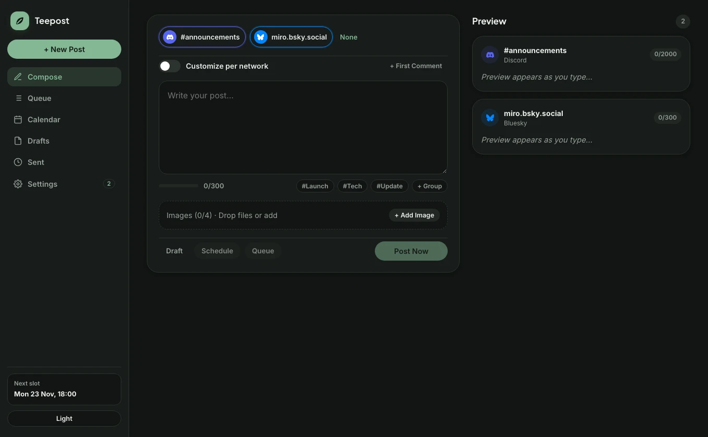

# Teepost (v0.1.0-alpha)

> **Alpha Software Notice:** Teepost is currently in early **v0.1.0-alpha** experimental stage. There is **no warranty** of any kind. Live publishing against external social network APIs has not yet been battle-tested in production - use at your own risk and test your channels before relying on scheduled posts.

> **Security:** Teepost has no dashboard password until you set one in Settings. Bind it to localhost, or set `ADMIN_PASSWORD` and put it behind a reverse proxy with TLS before exposing it. Do not publish port 8787 directly to the internet.

Your lightweight, self-hosted Buffer alternative in a single ~15 MB RAM container. Write once, attach images, queue posts on a weekly schedule, and publish everywhere without subscriptions or external databases.



## Links
* [Releases](https://github.com/miromaik/teepost/releases)
* [Container Image](https://github.com/miromaik/teepost/pkgs/container/teepost)

## Features
* **5 Built-In Platforms:** Cross-post text and up to 4 images to X, Bluesky, Telegram, Discord, and Mastodon concurrently.
* **Buffer-Style Queue & Calendar:** Set recurring weekly posting slots, shuffle or reorder queued posts, pause the queue anytime, and inspect your Month/Week content calendar.
* **First Comment & Hashtag Groups:** Automatically post a reply comment (links, extra tags) right after your main post, and insert saved hashtag presets in one click.
* **Auto Image Compression:** Resizes and compresses photos over 950 KB right in your browser so Bluesky uploads never fail.
* **100% Web-Configured:** Connect channels, manage schedules, set timezone/clock format, and enable an optional dashboard password directly inside Settings.

## Tech Stack
* **Runtime:** Go 1.24 (CGO-free single binary)
* **Frontend:** React 19 + TypeScript + Vite (embedded via `go:embed`)
* **Database:** SQLite (`modernc.org/sqlite`)

## Quick Start

### Option 1: 1-Click Deploy in Dockge / Portainer
Paste this into **Dockge** or **Portainer Stacks**, click **Deploy**, and open `http://localhost:8787`:

```yaml
services:
  teepost:
    image: ghcr.io/miromaik/teepost:latest
    container_name: teepost
    restart: unless-stopped
    ports:
      - "127.0.0.1:8787:8787"
    environment:
      TZ: Europe/Warsaw
    volumes:
      - teepost_data:/app/data

volumes:
  teepost_data:
```

### Option 2: One-Line Docker Run
```bash
docker run -d --name teepost -p 127.0.0.1:8787:8787 -e TZ=Europe/Warsaw -v teepost_data:/app/data --restart unless-stopped ghcr.io/miromaik/teepost:latest
```

### Option 3: Build Locally (Docker or Single Binary)
```bash
# Build & run locally with Docker Compose
docker compose up -d --build

# Or build the single binary
just build
./teepost
```

Open `http://localhost:8787` in your browser.

```bash
# Run tests
just test
```

## Configuration
| Variable | Default | Purpose |
| --- | --- | --- |
| `PORT` | `8787` | HTTP listen port. |
| `DB_PATH` | `./data/crossposter.db` | SQLite database path. |
| `MEDIA_DIR` | `./data/media` | Uploaded media directory. |
| `ADMIN_PASSWORD` | empty | Seeds the dashboard password on first start. Ignored if a password already exists; change it from Settings. |
| `TZ` | `UTC` | Timezone used to resolve weekly queue slots. |

## License
MIT (c) 2026 Miro
